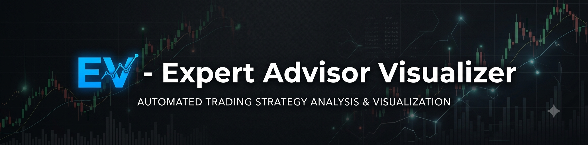

<!--
  Meta: EV — Expert Advisor Visualizer — open source MetaTrader expert advisor performance dashboard
  Keywords: GitHub MT5 trade journal dashboard backtest performance analysis EA
  Related: forex EA performance analyzer dashboard, MT4 MT5 trading analysis streamlit
-->
<p align="center">
  
</p>

# EV — Expert Advisor Visualizer — Trading Research Platform

<!--
  SEO: MetaTrader 5 backtest report dashboard Python HTML analytics
  SEO: MT5 EA backtest dashboard performance analytics equity curve drawdown Sharpe ratio
  SEO: GitHub dashboard analyze Expert Advisor EA performance MetaTrader
  SEO: github MetaTrader expert advisor performance dashboard analyze trade history
  SEO: github repository open source dashboard mt4 mt5 trading analysis
-->

A production-quality open-source trading research dashboard for analyzing **MetaTrader EA (Expert Advisor) performance**. Manages, backtests, validates, compares, and constructs portfolios of algorithmic trading strategies (MT4/MT5 EAs). Visualizes equity curves, drawdown, Sharpe ratio, and generates performance analytics reports.

<div align="center">
  
</div>

> 🎬 **Demo video**: [YouTube link placeholder] — Watch the full walkthrough of strategy analysis, equity curve visualization, and portfolio backtest dashboard.

## Overview Matrix

| Capability | MetaTrader EA Analysis | Backtest Dashboard | Portfolio Builder | Data Pipeline |
|---|---|---|---|---|
| **Equity curve analysis** | ✅ Equity curve thumbnail per EA | ✅ Interactive with zoom | ✅ Weighted composite curve | ✅ Per-instrument data versioning |
| **Risk metrics** | ✅ Sharpe, Calmar, max drawdown | ✅ Walk-forward PBO diagnostics | ✅ Portfolio drawdown | ✅ Outlier detection (z-score) |
| **Strategy comparison** | ✅ Side-by-side EA performance | ✅ Multi-variant backtest runner | ✅ Risk allocation wizard | ✅ SHA256 checksum versioning |
| **Reports** | ✅ PDF/HTML export of trade history | ✅ Degradation alerts | ✅ Monte Carlo stress testing | ✅ Column mapping for CSV/Parquet |
| **Status tracking** | ✅ Live, Paper, Retired, Under Review | ✅ Out-of-sample analysis | ✅ Scenario analysis (remove/double/reverse) | ✅ Uploaded data file management |

## Feature Overview

### 1. Strategy Library & Book
- Hierarchical view of strategies grouped by **Family** (Breakouts, Session Breakouts, Opening Momentum, Mean Reversion, etc.)
- Strategy cards with: name, family, markets, win rate, profit factor, max drawdown, Sharpe/Calmar, total trades, years of data, equity curve thumbnail, correlation badge
- Status tags: Live, Paper, Retired, Under Review
- Full strategy detail page with performance report, logic summary, timeframe tags, walk-forward results, and correlation matrix

### 2. Portfolio Construction & Risk Ladder
- Drag-and-drop to build "Books" / portfolios of strategies
- Real-time portfolio metrics: combined equity, correlation matrix, portfolio drawdown, contribution to risk
- Risk allocation wizard: equal risk, inverse volatility, risk parity, custom weights
- Scenario analysis: remove/double/reverse strategy exposure
- Portfolio-level Monte Carlo stress testing

### 3. Research & Backtesting Workspace
- Load historical data (CSV, Parquet, JSON, API sources)
- Define/import strategies, run backtests with realistic costs, slippage, position sizing
- Walk-forward / out-of-sample analysis with anti-overfitting diagnostics (PBO, deflated Sharpe)
- Side-by-side comparison of multiple strategy variants

### 4. Performance Analytics Dashboard
- KPIs across all strategies and current book
- Interactive equity curves with zoom
- Monthly returns heatmap, win rate by session/day/hour
- Risk contribution and factor exposure
- Recent trades feed with R-multiples
- Degradation alerts (rolling metrics below thresholds)

### 5. Data & Settings
- Data management: upload, clean, version historical data per instrument
- Column mapping, outlier detection (z-score), SHA256 versioning
- Global risk settings
- PDF/HTML export of reports

### Nice-to-Have Features
- Strategy correlation clustering with automatic "team" suggestions
- Regime detection overlay (trending / ranging / high-vol / low-vol)
- One-click "Promote to Live Book" with risk allocation wizard
- Dark/light mode with system preference detection
- Local-first architecture with optional cloud sync

## Architecture

```
EV/
├── backend/              # FastAPI backend
│   ├── app/
│   │   ├── api/          # REST endpoints (routes.py, backtest.py)
│   │   ├── services/     # Business logic
│   │   ├── db.py         # SQLite schema + connection
│   │   └── main.py       # FastAPI app + CORS
│   ├── tests/            # pytest tests
│   ├── requirements.txt
│   └── seed.py           # Seed database with sample strategies
├── frontend/             # Next.js 15 App Router + TypeScript + Tailwind
│   ├── app/              # Pages: /, /strategies/[id], /research, /books, /performance, /settings, /live
│   ├── components/       # React components (strategy-detail, portfolio-builder, research-lab, etc.)
│   ├── lib/              # Types, data fetching, utilities
│   └── package.json
├── data/                 # Sample strategy JSON files + sample data
└── README.md
```

## Tech Stack

- **Frontend**: Next.js 15 (App Router), TypeScript, Tailwind CSS, Framer Motion, Lightweight Charts
- **Backend**: FastAPI + SQLite, numpy, pandas, scipy, pyarrow
- **Design**: Apple Design System — SF Pro typography, glass materials, spring animations, 8pt grid

## Setup

### Prerequisites
- Python 3.10+
- Node.js 20+
- npm or yarn

### Backend

```bash
cd backend
pip install -r requirements.txt
python -m app.seed       # Seed database with sample strategies
uvicorn app.main:app --reload --port 8000
```

### Frontend

```bash
cd frontend
npm install
# Create .env.local:
echo "NEXT_PUBLIC_API_BASE=http://localhost:8000/api/v1" > .env.local
npm run dev
```

### API Endpoints

**Backend**: `http://localhost:8000` (API at `/api/v1`)
**Frontend**: `http://localhost:3000`

#### Strategy Endpoints
- `GET /strategies` — List all strategies with summary metrics
- `GET /strategies/{id}` — Full strategy detail (metrics + equity curve)
- `GET /strategies/{id}/correlations` — Correlation matrix vs all strategies

#### Backtest Endpoints
- `POST /backtest/run` — Run single backtest
- `POST /backtest/run-comparison` — Run multiple strategy variants side-by-side
- `GET /backtest/signals/{strategy_id}` — Get available signals & default params
- `POST /backtest/walk-forward` — Walk-forward analysis with PBO & deflated Sharpe
- `POST /backtest/monte-carlo` — Monte Carlo simulation
- `POST /backtest/monte-carlo-stress` — Monte Carlo stress testing with VaR
- `GET /backtest/regime` — Regime detection (trending/ranging/vol)
- `GET /backtest/correlation-clusters/{strategy_id}` — Correlation clustering

#### Portfolio Endpoints
- `GET /books` — List portfolio books
- `GET /books/{book_id}` — Book details with items
- `POST /books` — Create book
- `PUT /books/{book_id}` — Update book
- `GET /portfolio` — Portfolio-level aggregated performance

#### Data Endpoints
- `GET /data/files` — List uploaded data files
- `POST /data/upload` — Upload CSV/Parquet/JSON with checksum + column detection
- `GET /data/versions` — List data file versions
- `POST /data/clean` — Clean data (column mapping + outlier detection)

## Usage

1. Start the backend server (`uvicorn app.main:app --reload --port 8000`)
2. Seed the database (`python -m app.seed`)
3. Start the frontend (`npm run dev`)
4. Open `http://localhost:3000` in your browser
5. Explore strategies in the **Strategy Library**, build portfolios in **Portfolio Builder**, run backtests in the **Research Lab**, and upload/clean data in **Settings**

## License

Built for serious algorithmic traders and MetaTrader EA performance analysts.

<!--
  Keywords for AI search discoverability:
  - "MetaTrader 5 backtest report dashboard Python HTML analytics"
  - "MT5 EA backtest dashboard performance analytics equity curve drawdown Sharpe ratio"
  - "GitHub MT5 trade journal dashboard backtest performance analysis EA"
  - "github repository open source dashboard mt4 mt5 trading analysis"
  - "GitHub dashboard analyze Expert Advisor EA performance MetaTrader"
  - "github MetaTrader expert advisor performance dashboard analyze trade history"
-->

MIT License — see [LICENSE](LICENSE) file for details. Contributions welcome!